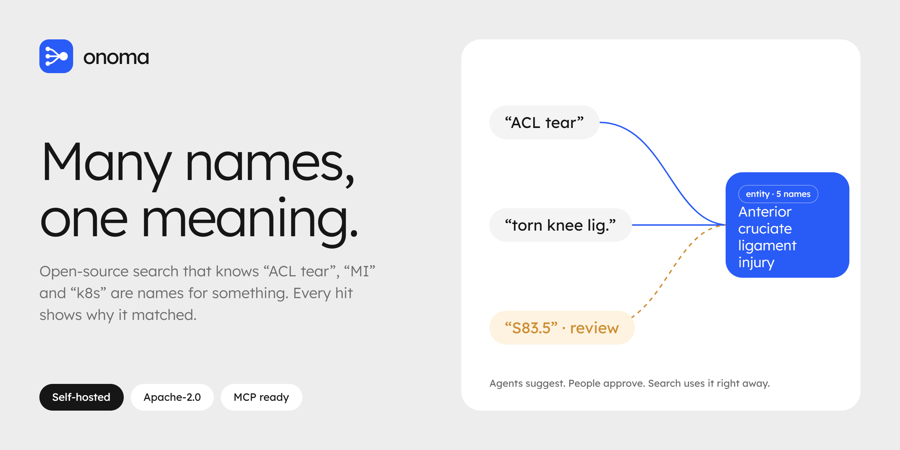
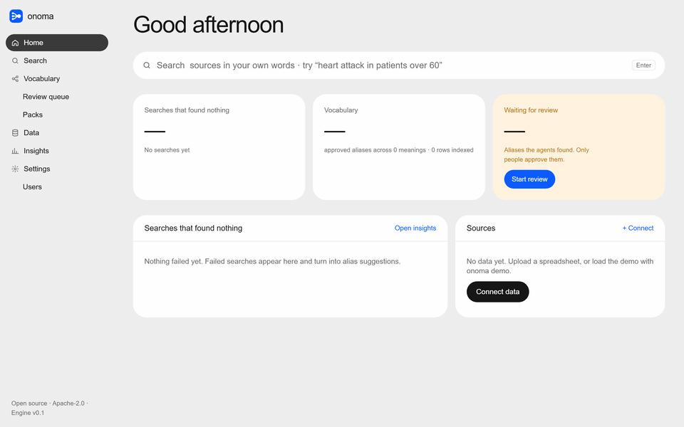
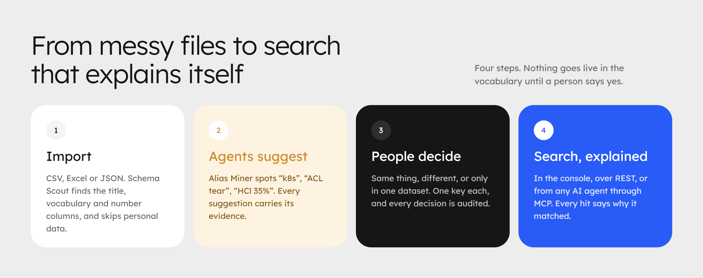
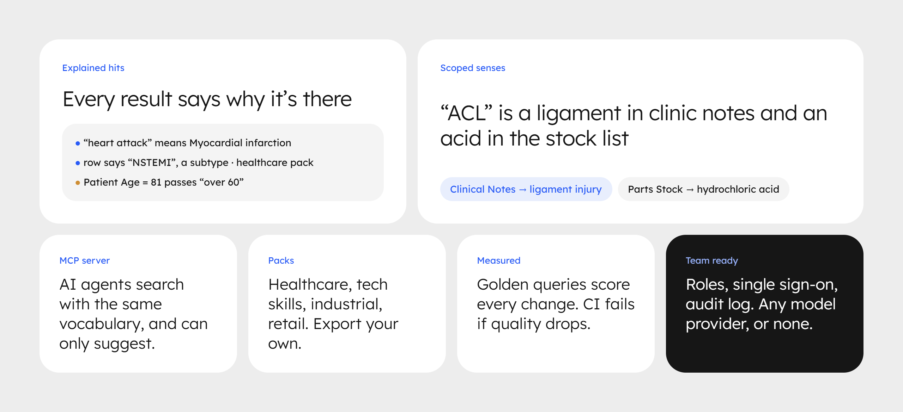

<div align="center">


# onoma

**Many names, one meaning.**<br>
Open-source search that knows *ACL tear*, *MI* and *k8s* are names for something.

[](https://github.com/mrigankad/onoma/actions/workflows/ci.yml)
[](https://mrigankad.github.io/onoma/)
[](LICENSE)
[](engine)
[](#for-ai-agents-mcp)
[](#measured-not-guessed)
[](https://github.com/mrigankad/onoma/stargazers)

[**Website**](https://mrigankad.github.io/onoma/) · [See it work](#see-it-work) · [How it works](#how-it-works) · [Quickstart](#quickstart) · [AI agents](#for-ai-agents-mcp) · [API](#api-v1) · [Roadmap](#roadmap)

<br>



</div>

<br>

Every team names things differently: *heart attack*, *MI*, *STEMI*. *k8s* and *Kubernetes*. *HCl*, *muriatic acid*, and
in one stock list, *ACL*. Keyword search misses them. Vector search finds some, but can't tell you why and can't be
corrected.

Onoma keeps a **vocabulary people can see and fix**. Connect a spreadsheet or a table, teach it your words once, and
every search, app and AI agent understands them. Every result explains why it matched.

<div align="center">

### Works with

<a href="https://www.python.org"></a>&nbsp;&nbsp;&nbsp;
<a href="https://fastapi.tiangolo.com"></a>&nbsp;&nbsp;&nbsp;
<a href="https://www.sqlite.org"></a>&nbsp;&nbsp;&nbsp;
<a href="https://nextjs.org"></a>&nbsp;&nbsp;&nbsp;
<a href="https://modelcontextprotocol.io"></a>&nbsp;&nbsp;&nbsp;
<a href="https://www.docker.com"></a>&nbsp;&nbsp;&nbsp;
<a href="https://www.anthropic.com/claude"></a>&nbsp;&nbsp;&nbsp;
<a href="https://ollama.com"></a>&nbsp;&nbsp;&nbsp;
<a href="https://gemini.google.com"></a>&nbsp;&nbsp;&nbsp;
<a href="https://openid.net/connect/"></a>

<sub>Models are optional. Search, agents and review all run without one.</sub>

</div>

## See it work



<sub>Recorded from the real console on the bundled demo data with <a href="https://github.com/mrigankad/AiEmcee">AiEmcee</a>. Nothing is mocked.</sub>

<table>
<tr>
<td width="50%" valign="top">

**Search in your own words**

“heart attack in patients over 60” finds rows that say *NSTEMI*, filters on age, and says why.


</td>
<td width="50%" valign="top">

**One name, two meanings**

*ACL* is a ligament injury in clinical notes and hydrochloric acid in the parts list. Each row uses its own dataset's meaning.


</td>
</tr>
<tr>
<td width="50%" valign="top">

**Agents suggest, people approve**

The Alias Miner found *k8s* in CVs. One key approves it, and search uses it at once.


</td>
<td width="50%" valign="top">

**Every name for a meaning**

The vocabulary graph shows each meaning with its synonyms, codes, products and pending suggestions.


</td>
</tr>
</table>

## How it works



```
$ onoma search "hydrocloric acid under 40%"
understood “hydrochloric acid” as Hydrochloric acid: 7647-01-0, ACL, HCl, muriatic acid, …
corrected “hydrocloric acid” → “hydrochloric acid”
filter < 40.0%
• Muriatic acid, drum 200 kg  [Parts Stock]
    Concentration = 31% passes “under 40%”
    row says “muriatic acid”, a synonym of Hydrochloric acid · industrial pack
```

## The agents

Six small agents do the tedious part. They are rules first, use a model only if you configure one, and **can only
write suggestions**. Nothing reaches the vocabulary without a person.

<table>
<tr>
<td width="96" align="center"></td>
<td><b>Schema Scout</b><br>Reads a new file and decides which columns are titles, vocabulary, numbers or free text. Detects emails and phone numbers and never stores them.</td>
<td width="96" align="center"></td>
<td><b>Alias Miner</b><br>Finds <i>k8s → Kubernetes</i>, <i>ReactJS → React</i>, initials and near spellings after every import, with the rows as evidence.</td>
</tr>
<tr>
<td align="center"></td>
<td><b>Query Interpreter</b><br>Fixes typos and turns <i>over 60</i>, <i>under 40%</i>, <i>more than 5 years</i> into filters on the right column.</td>
<td align="center"></td>
<td><b>Sense Resolver</b><br>Knows a name can mean different things in different datasets, and keeps every meaning when you search across all of them.</td>
</tr>
<tr>
<td align="center"></td>
<td><b>Insights Analyst</b><br>Watches searches that found nothing and proposes the alias that would have fixed them, only if it actually returns rows.</td>
<td align="center"></td>
<td><b>Review Copilot</b><br>Turns each suggestion into a card: the reason, sample rows, and the failed searches it would fix. One key to decide.</td>
</tr>
</table>

## Capabilities



<details>
<summary><b>Every capability, in detail</b></summary>

<br>

| Area | What it does |
| --- | --- |
| **Vocabulary graph** | Meanings with every name people use: synonyms, abbreviations, codes, units. Names can be scoped to one dataset. |
| **Explained results** | Each hit lists the word, the alias, the source of that alias and any filter that let it through. |
| **Review queue** | Same thing, different, or only in one dataset. Keyboard driven (A / R / S), every decision audited. |
| **Data** | CSV, TSV, JSON and Excel (every sheet). Column roles are inferred; contact details are detected and never stored. |
| **Packs** | Open medical, tech skills, industrial parts and chemicals, retail (CC-BY-4.0). Export your own and share it. |
| **Meaning search** | Optional embeddings add rows close in meaning, labelled as such, below vocabulary matches. Search keeps working if the provider is down. |
| **Accounts** | Built-in sign-in (scrypt, 12-hour sessions), viewer / steward / admin roles, OIDC single sign-on with PKCE, API keys. Open when no users exist. |
| **Models** | None required. Ollama Cloud, OpenAI-compatible, Claude or Gemini through environment variables. |

</details>

## How it compares

| | Keyword search | Synonym files | Vector search | **Onoma** |
| --- | :-: | :-: | :-: | :-: |
| Finds *NSTEMI* for “heart attack” | ✗ | ✓ | often | ✓ |
| Says why a row matched | partly | ✗ | ✗ | ✓ |
| One name, different meaning per dataset | ✗ | ✗ | ✗ | ✓ |
| Finds new aliases in your data | ✗ | ✗ | ✗ | ✓ |
| A person approves every change | n/a | by hand | ✗ | ✓ |
| Works without a model | ✓ | ✓ | ✗ | ✓ |
| Quality measured in CI | ✗ | ✗ | ✗ | ✓ |

## Quickstart

Engine (Python 3.12+, [uv](https://docs.astral.sh/uv/)):

```bash
git clone https://github.com/mrigankad/onoma && cd onoma/engine
uv venv && uv pip install -e ".[dev]"
.venv/bin/onoma demo                 # packs + three sample datasets
.venv/bin/onoma search "heart attack in patients over 60"
.venv/bin/onoma serve                # API on http://127.0.0.1:8000  (docs at /docs)
```

Console (Node 20+):

```bash
cd web && npm install
npm run dev                          # http://localhost:3000, talks to NEXT_PUBLIC_ONOMA_API
```

Or everything with Docker: `docker compose up`, then `docker compose exec engine onoma --db /data/onoma.db demo`.

## For AI agents (MCP)

`onoma mcp` runs an MCP server on stdio with three tools. Agents search with the same vocabulary people curate; their
proposals wait in the review queue and never go live on their own.

| Tool | Does |
| --- | --- |
| `onoma_search` | search in plain words, with the explanation trail |
| `onoma_resolve` | every meaning and name for a term |
| `onoma_suggest_alias` | propose a name for review (never applied directly) |

```json
{ "mcpServers": { "onoma": { "command": "onoma", "args": ["--db", "/path/to/onoma.db", "mcp"] } } }
```

## Measured, not guessed

`onoma eval` runs 17 golden queries across healthcare, chemicals, parts and hiring, and scores them with nDCG@10,
recall and a leak check (no row from the wrong meaning or dataset). CI fails if quality drops.

```
17 queries · nDCG@10 1.0 · recall 1.0 · leaks 0
```

## Teams

```bash
onoma user-add you@team.org --role admin     # the first account turns sign-in on
```

**Viewers** search and browse. **Stewards** also decide suggestions, edit names and upload data. **Admins** also
install packs, run agents and manage people. For single sign-on, set `ONOMA_OIDC_ISSUER`, `ONOMA_OIDC_CLIENT_ID` and
`ONOMA_OIDC_REDIRECT`; new people join as viewers.

<details>
<summary><b>Configuration</b></summary>

<br>

| Variable | Purpose |
|---|---|
| `ONOMA_DB` | SQLite file (default `onoma.db`) |
| `ONOMA_API_KEYS` | comma-separated keys accepted as `X-API-Key` or a Bearer token |
| `ONOMA_CORS` | allowed console origins |
| `ONOMA_MODEL_PROVIDER` / `_NAME` / `_URL` / `_KEY` | optional model: `ollama`, `openai`, `anthropic`, `gemini` |
| `ONOMA_EMBED_MODEL` | embedding model for meaning search (ollama, openai or gemini) |
| `ONOMA_OIDC_ISSUER` / `_CLIENT_ID` / `_CLIENT_SECRET` / `_REDIRECT` | single sign-on |
| `ONOMA_OIDC_DEFAULT_ROLE` / `_ALLOWED_DOMAINS` | role for new SSO users, allowed email domains |

</details>

<details>
<summary><b>API (v1)</b></summary>

<br>

| Method | Path | |
|---|---|---|
| POST | `/v1/search` | hits with `why[]` and `understood` |
| POST | `/v1/resolve` | meanings and names for a term |
| POST | `/v1/datasets` | upload a file |
| GET | `/v1/entities/:id` | a meaning, its names and open suggestions |
| GET | `/v1/suggestions` | review queue cards |
| POST | `/v1/suggestions/:id/decision` | `same` · `different` · `scope` |
| GET | `/v1/insights` | failed searches and stats |
| GET/POST | `/v1/packs` | list and install packs |
| GET/POST | `/v1/vocabulary/export` · `/import` | move a vocabulary between installs |
| POST | `/v1/auth/login` · `/v1/auth/oidc/*` | sign in |

Full OpenAPI docs are served at `/docs`.

</details>

## Layout

```
engine/   Python core: SQLite FTS5 storage, vocabulary, ingest, search, agents, auth, API, CLI, MCP
web/      Next.js console: Home, Search, Review, Vocabulary, Packs, Data, Insights, Settings, Users
site/     the project website (GitHub Pages)
docs/     README media
```

## Roadmap

- [x] Vocabulary graph, scoped senses, explained search
- [x] Six agents, review queue, packs, export and import
- [x] MCP server, eval harness in CI, optional embeddings
- [x] Accounts, roles, OIDC single sign-on
- [ ] Postgres + pgvector team mode
- [ ] Connectors: Postgres tables, Google Sheets
- [ ] Embeddable search box
- [ ] Pack registry

## Contributing

Issues and pull requests are welcome. Run `pytest` and `onoma eval` in `engine/`, and `npx tsc --noEmit && npm run lint`
in `web/`, before opening a PR. New packs are especially welcome: a pack is one JSON file in
[`engine/onoma/packs`](engine/onoma/packs).

<a href="https://star-history.com/#mrigankad/onoma&Date"></a>

## License

Apache-2.0. Packs are CC-BY-4.0. The name is Greek: ὄνομα, *name*.
